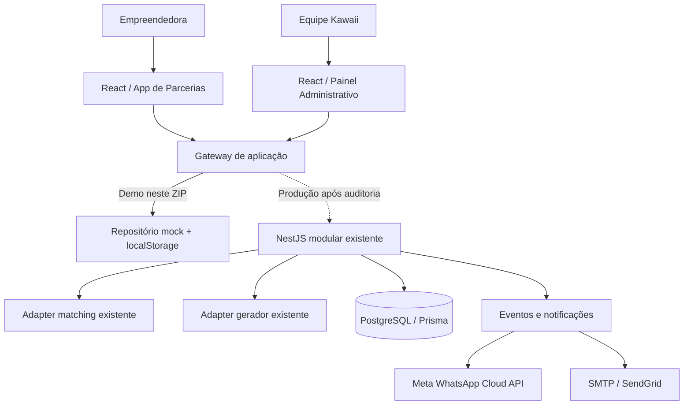

# Arquitetura — decisões e fronteiras

## 1. Visão de produto

A tese central acordada: o valor produzido pela Kawaii é a **parceria executada com benefício confirmado**, não um match isolado. Match, interesse, proposta, aceite e entrega possuem evidências e estados diferentes.

**Prioridade P0:** conectar recomendação → rascunho revisável. **P1:** ativação e comunicação WhatsApp/e-mail com eventos confiáveis. **P2:** avaliação estatística, extração semântica e modelos supervisionados, se justificados.

## 2. Contexto de execução



As linhas pontilhadas representam **plano de integração futuro**, não funcionalidades conectadas neste pacote.

## 3. Front-end por domínio

```text
apps/web/src/
  app/                 Router, guards de demonstração e hooks
  components/          Layouts e primitivas visuais compartilhadas
  domain/              Contratos, elegibilidade, proposta, regras de comunicação
  features/
    auth/              Perfis de acesso da demo
    opportunities/     Início, perfil, recomendações, evidências
    proposals/         Lista e editor de rascunhos
    community/         Dashboard, integrantes, comunicação, eventos, relatórios
  infrastructure/      Fixtures, mock gateway e localStorage
  styles/              Identidade e motion tokens
  assets/               Logo recebida
```

**Limite de segurança:** os guards React impedem navegação por papel **somente na demo**. Em produção, cada endpoint revalida JWT, escopo, participante, oportunidades e permissões no servidor.

## 4. Backend-alvo (NestJS)

| Camada | Responsabilidade |
|---|---|
| Controller / Presentation | Autenticação, parsing, serialização, errors HTTP |
| Application / use cases | Listar recomendações, iniciar proposta, atualizar, acompanhar |
| Domain / policies | Regras por modalidade, elegibilidade e transição de estado |
| Ports | Interfaces que isolam matching e geração existentes |
| Adapters | Traduzir fontes existentes para contratos canônicos |
| Persistence | Prisma transacional e indexes específicos |
| Integration events | Notificações, telemetria, retries e consentimento |

**API demonstrativa em `apps/api`:** prova de conceito NestJS com memória, sem ligação com banco nem sistemas de produção. Serve para estudar o contrato, não para servir dados reais.

## 5. Contratos e entidades

`Participant` (quem), `Opportunity` (demanda/objetivo), `Recommendation` (evidência/sinais), `Proposal` (termos e versões), `Communication` (canal e status), `ClubEvent` (atividade e presença), `TelemetryEvent` (transições observadas).

`Modality = SUPPORT | EXCHANGE | COLLAB`; `Relation = PEER | COMPANY`. Uma oportunidade com empresa **não é automaticamente uma quarta modalidade**. O YAML antigo do planejamento enumera `COMMERCIAL` como modalidade; **é necessário reconciliar** esse ponto com o modelo real antes de integração.

## 6. State machines (resumo)

**Proposta:** `DRAFT -> READY_FOR_REVIEW` no protótipo. `SENT -> ACCEPTED -> EXECUTED` e rejeição/encerramento pertencem ao roadmap futuro e ao fluxo real de chats e aceite bilateral.

**Comunicação:** `SCHEDULED -> PROCESSING -> SENT -> DELIVERED` (quando provedor comprova) ou `FAILED`. `SCHEDULED -> CANCELED`. `FAILED -> SCHEDULED` para retentativa autorizada. Na demo, processamento manual retorna `SENT` ou `FAILED`, **nunca finge confirmação de entrega**.

**Presença:** inscrição ≠ confirmação ≠ check-in. A presença demonstrativa é manual, não presume leitura de grupos WhatsApp, Meet ou Zoom.

## 7. Consistência e idempotência

A demo garante invariantes apenas no armazenamento de uma aba do navegador. Em produção:

- Chave de idempotência associada a usuário, operação e hash de payload, com `UNIQUE` no banco.
- Recuperar recurso e revalidar oportunidade **na mesma transação** onde cria rascunho, evitando TOCTOU.
- Atualização de rascunho exige versão esperada (compare-and-swap).
- Não confiar em IDs recebidos do front-end como prova de elegibilidade.
- Retries com backoff, limites e DLQ/outbox apenas quando necessário.
- Logs com correlationId e referências não sensíveis; não persistir CPF ou segredos em eventos.

## 8. Dados e segurança

- Ambiente demonstra **10 integrantes fictícias**, o desafio usa um **cenário de 150**.
- Não deduzir consentimento real dos booleanos de fixtures; em produção registrar origem, finalidade, data e opt-out.
- Não disponibilizar CPF, dados financeiros ou bios integrais para LLMs ou logs sem necessidade comprovada.
- Para WhatsApp oficial, verificar templates, janela de atendimento, rate limits, webhooks e credenciais.
- E-mail requer SPF/DKIM/DMARC, tratamento de bounce e descadastro quando aplicável.
- `localStorage` não é armazenamento de produção e não garante consistência transacional entre abas.

## 9. Performance e custos

Começar com PostgreSQL indexado, busca SQL/FTS e matching explicável. Não adicionar Redis, Elasticsearch, banco vetorial, serviço Python ou LLM síncrono na consulta de matches. Medir p50/p95, cobertura, custo por proposta e resultado. O objetivo p95 <= 300 ms na especificação é **meta provisória de homologação**, não SLA comprovado.

## 10. Design e motion

A identidade cromática parte da logo e das referências anexadas: vermelho `#6A0004`, profundo `#4F0004`, creme `#F7F3EC`, marfim `#FFFDF7` e dourado `#B18A57` como detalhes. A versão React usa **Cormorant Garamond** (títulos editoriais), **Bricolage Grotesque** (destaques) e **Figtree** (interface), coerentes com o design system definido no planejamento. O HTML original possui definições dessas três fontes, embora seu link de carregamento use fontes diferentes. **Antes de integrar ao aplicativo oficial, comparar com os tokens reais do repositório**. O arquivo original permanece intacto em `reference/`.

Motion: hover ~160–220 ms, entrada editorial ~300 ms, uso de opacity/transform, e `prefers-reduced-motion`.
